<h1>
  <picture>
    <source media="(prefers-color-scheme: dark)" srcset=".github/logotipo-crm-negativo.svg">
    
  </picture>
</h1>

CRM de cobrança: um credor importa a carteira de clientes e títulos a partir de planilhas, acompanha quem deve e quanto, registra os pagamentos e os estornos recebidos pelos seus canais, registra os contatos feitos com cada cliente, controla quem acessa o quê e mantém o histórico de cada alteração. Vários credores convivem no mesmo sistema, e cada pessoa vê só os credores em que tem permissão.

O projeto é desenvolvido por incrementos, cada um a partir de uma especificação aprovada antes do código. A discussão de cada incremento é contada na série [Criei um CRM](https://blog.areacli.com/criei-um-crm/), no Blog AreaCli.

## Demonstração

https://crm.areacli.com, com dados fictícios recriados todo dia às 4h (horário de Brasília). Os arquivos enviados são descartados sem ser lidos e trocados por arquivos fictícios.

| Usuário | Senha | O que pode fazer |
|---|---|---|
| `gestor@demo.crm.areacli.com` | `demonstracao-gestor` | importar e confirmar carteira, pagamentos e estornos; registrar e anular acionamentos; canais de recebimento, políticas de pagamento e resultados de acionamento; transferir crédito entre contratos (usuários e perfis ficam fechados na demonstração; o que é digitado é trocado por texto fictício) |
| `operador@demo.crm.areacli.com` | `demonstracao-operador` | consultar clientes e fichas e registrar acionamentos |

## Telas

| | |
|---|---|
| 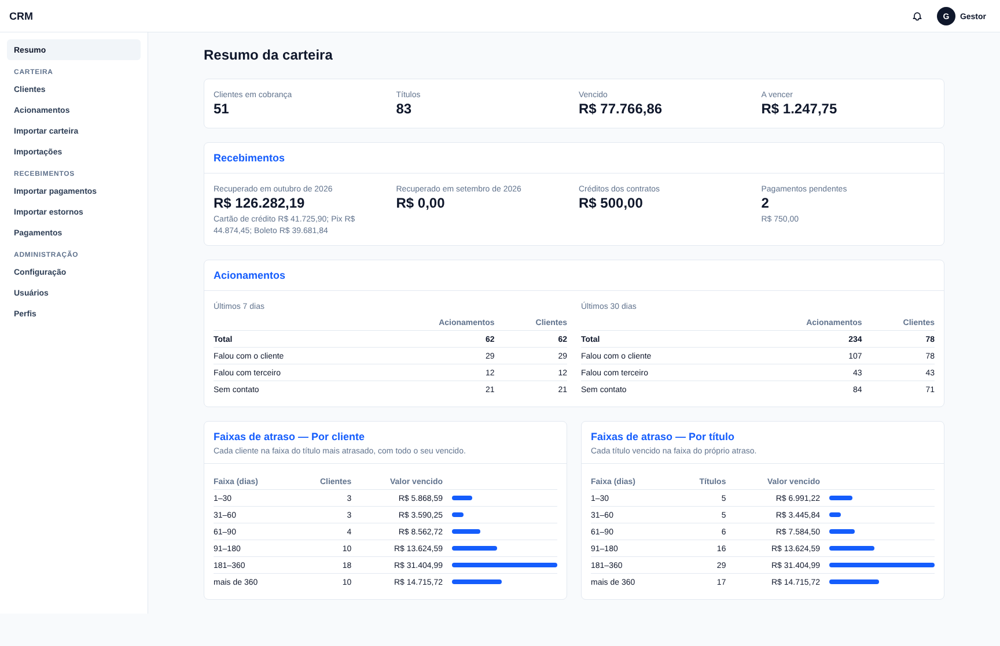 | 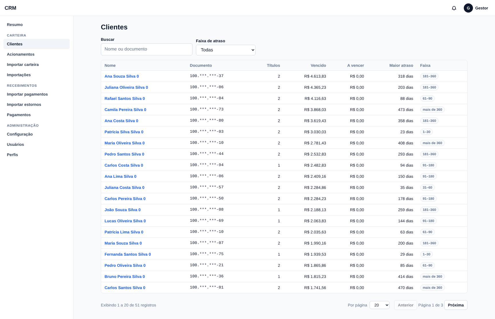 |
| Resumo da carteira: faixas de atraso, recuperado do mês por meio de pagamento, créditos e pendentes | Lista de clientes com valor vencido, a vencer e maior atraso |
| 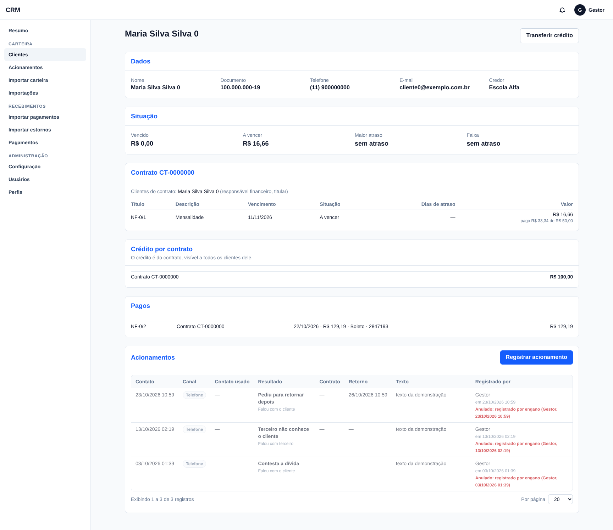 | 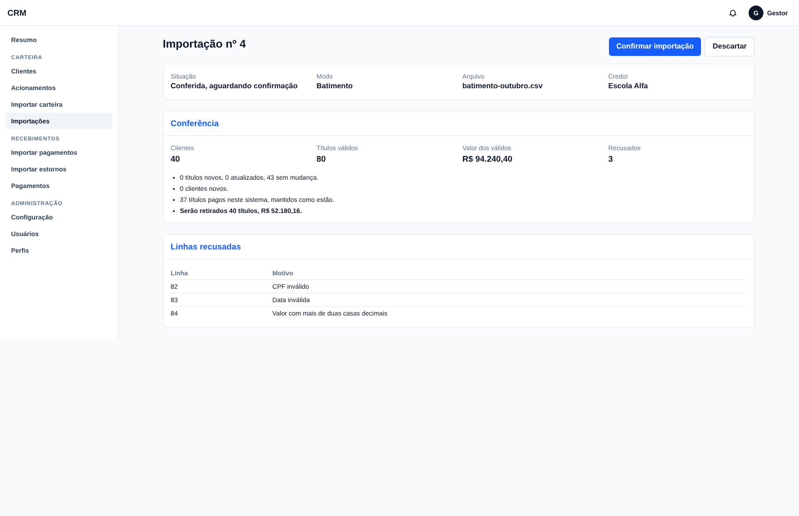 |
| Ficha do cliente: títulos por contrato, crédito do contrato e títulos pagos | Conferência antes de confirmar a carga: o que entra, o que sai e as linhas recusadas |
| 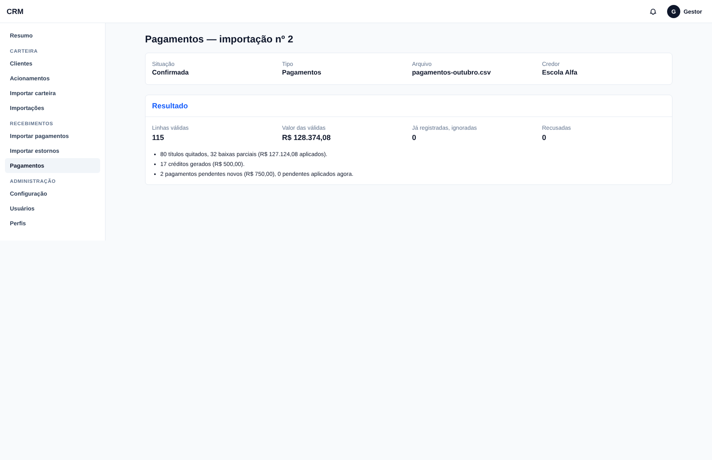 | 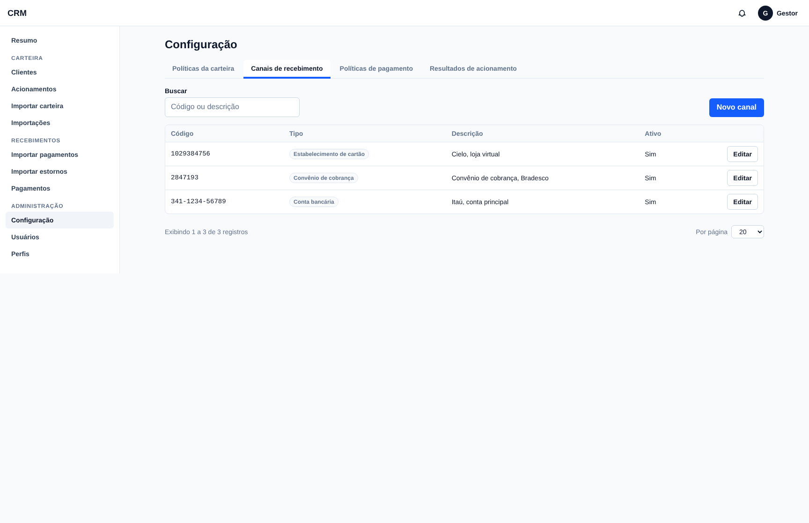 |
| Importação de pagamentos: títulos quitados, baixas parciais, créditos e pendentes | Canais de recebimento do credor |
| 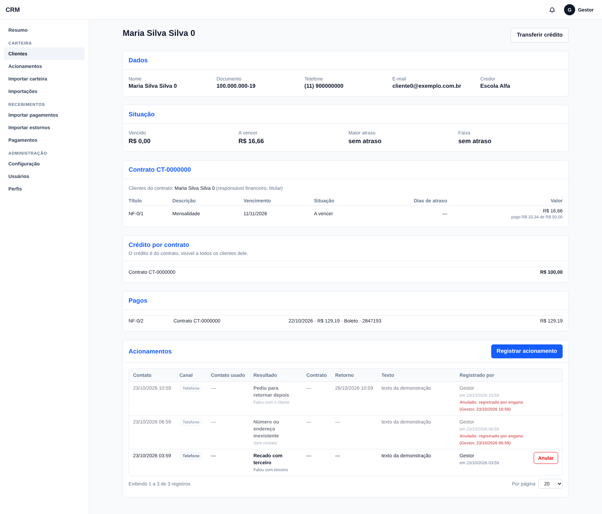 | 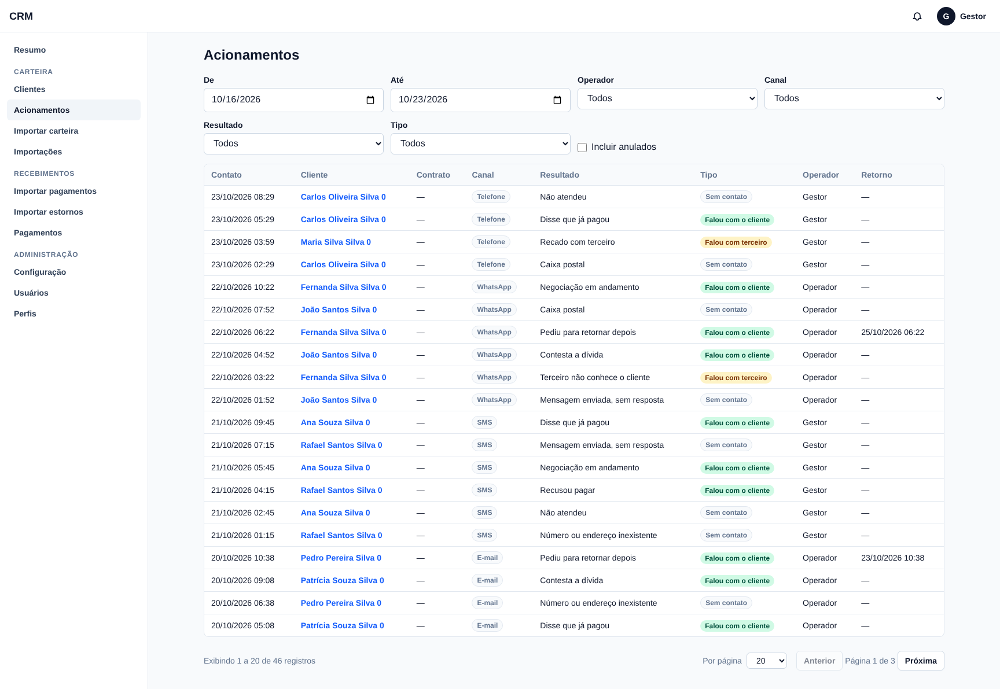 |
| Histórico de acionamentos na ficha, com o registro e a anulação | Lista de acionamentos do credor, com período, operador, canal e resultado |
| 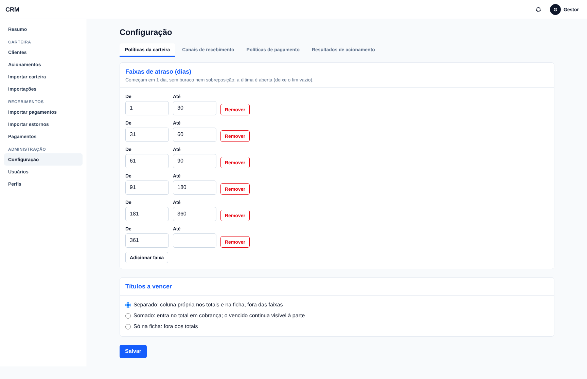 | 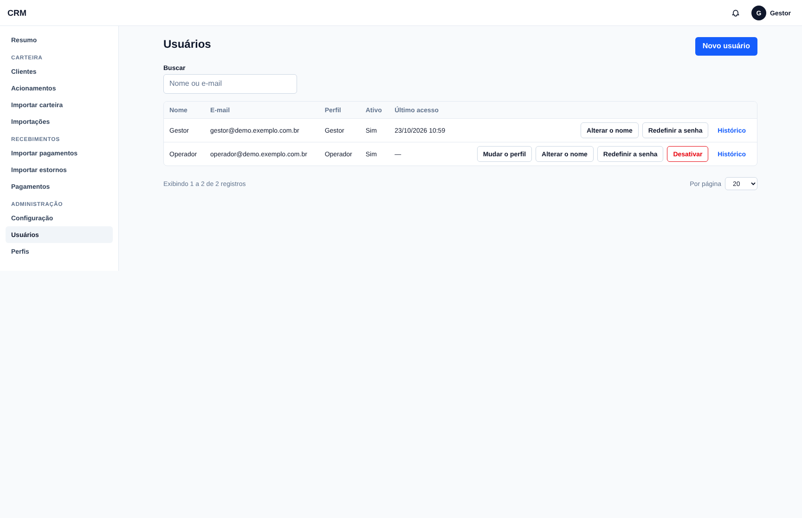 |
| Configuração: uma entrada no menu e uma aba por assunto | Usuários e seus perfis em cada credor |
| 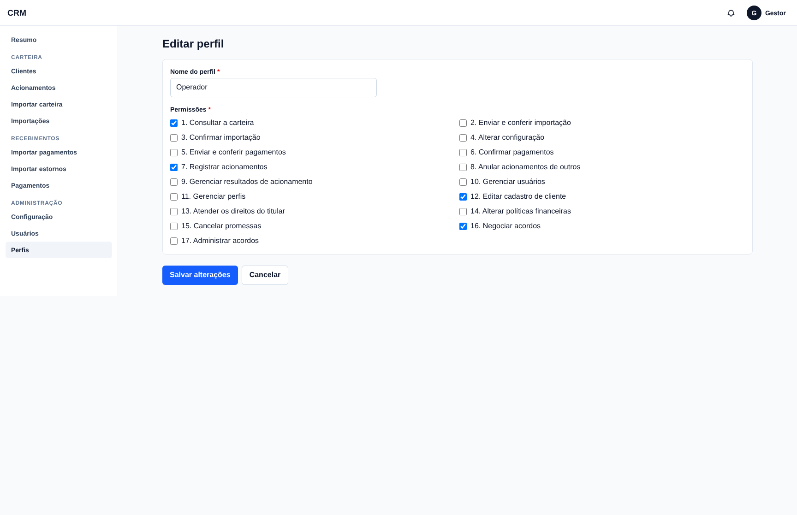 | |
| Perfil com as permissões escolhidas | |

## Incrementos

Uma branch por incremento (`incremento-01-carteira` … `incremento-04-acionamentos`). O `main` recebe cada uma depois que ela é publicada na demonstração.

| Incremento | O que entrega |
|---|---|
| 1. Carteira | Credores (tenants), importação da carteira por planilha CSV com conferência antes de confirmar (incremental ou batimento), contratos com vários clientes e seus papéis, lista de clientes com faixas de atraso, ficha, histórico de alterações e login |
| 2. Perfis e usuários | Perfis com permissões por credor, gestão de usuários identificados pelo e-mail, senha temporária, troca da própria senha, ligação de um usuário existente a outro credor e histórico de acessos |
| 3. Pagamentos e baixa | Canais de recebimento, importação de pagamentos e de estornos, baixa parcial ou crédito sem baixar conforme a política do credor, crédito do contrato e sua transferência entre contratos, pendentes reavaliados a cada conferência e o recuperado no resumo |
| 4. Acionamentos | Contatos com o cliente registrados na ficha (canal, contato usado, resultado de uma lista do credor, retorno e texto), anulação com motivo, lista com filtros, números no resumo por credor e a configuração reunida em abas |

## Tecnologia

PHP 8.5, Laravel 13, Livewire 4 e Tailwind 4, PostgreSQL 19, Pest 5. Fila e agendador do Laravel com o driver de banco. Tudo roda em contêineres Docker, com versões travadas. As importações grandes usam `COPY` e SQL em lote do PostgreSQL: 200 mil linhas de carteira ou de pagamentos se conferem e se confirmam em até cerca de 1 minuto cada.

## Como rodar

Só o Docker é necessário. Na raiz do repositório:

```sh
# Imagens: a da aplicação e a de testes (com Chromium, para os testes em navegador).
docker build -f deploy/Dockerfile --target app -t crm-laravel-php:8.5 .
docker build -f deploy/Dockerfile --target testes -t crm-laravel-php:8.5-testes .

# Ambiente de desenvolvimento: a senha do banco fica num arquivo que não vai para o git.
echo "DB_PASSWORD=$(openssl rand -hex 16)" > deploy/laravel/.env.dev
docker compose -f deploy/laravel/compose.dev.yml --env-file deploy/laravel/.env.dev up -d db

# Dependências e testes.
docker compose -f deploy/laravel/compose.dev.yml --env-file deploy/laravel/.env.dev run --rm --no-deps testes composer install
docker compose -f deploy/laravel/compose.dev.yml --env-file deploy/laravel/.env.dev run --rm --no-deps testes vendor/bin/pest
```

Para ver a aplicação com dados fictícios, no mesmo ambiente: `php artisan crm:demo-data` cria um credor, dois usuários (`gestor@demo.exemplo.com.br` e `operador@demo.exemplo.com.br`, senhas `demonstracao-gestor` e `demonstracao-operador`), uma carteira e recebimentos. A execução em produção usa `deploy/laravel/compose.producao.yml` e o modelo de variáveis `deploy/laravel/env.producao.modelo`.

## Licença

[GNU Affero General Public License v3.0](LICENSE).

Os comentários do código citam regras (R1, R2…) e decisões das especificações. As especificações são documentos internos do projeto e não estão neste repositório; a série no blog conta cada uma.
